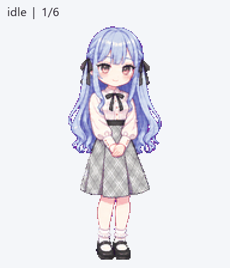
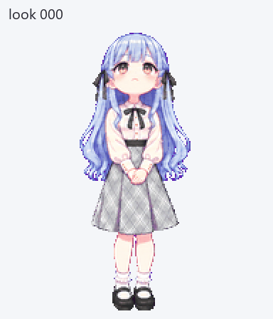

<div align="center">


# Sakiko Pixel Pet

<!-- moe-counter:start -->
<a href="https://github.com/journey-ad/Moe-Counter"></a>
<!-- moe-counter:end -->

*Sakiko in her everyday white blouse and gray plaid skirt, ready to keep you company.*


[简体中文](README.md) · **English**

</div>

---

## Contents

| Get started | More information |
| --- | --- |
| [Features](#features) | [Files and format](#files-and-format) |
| [Preview](#preview) | [Validation](#validation) |
| [Use the atlas](#use-the-atlas) | [Known limitations](#known-limitations) |

## Features

An unofficial pixel-style companion inspired by **Sakiko Togawa** from *BanG Dream! It's MyGO!!!!!* and *BanG Dream! Ave Mujica*, prepared for the ChatGPT Work Pets workflow.

| Asset | Description |
| --- | --- |
| Everyday outfit | White long-sleeved blouse, black neck bow, gray plaid skirt, white frilled socks, and black Mary Jane shoes. No mask or handheld props. |
| Nine animation states | Idle, right/left movement, waving, jumping, failure, waiting for input, active processing, and review: 57 frames. |
| Sixteen look directions | A clockwise gaze loop beginning at up: 16 frames. |
| Transparent v2 atlas | `1536 × 2288` RGBA PNG, 8 columns × 11 rows, `192 × 208` cells, 73 populated frames. |
| Preview and source art | Per-state GIFs, all-state GIF/MP4, jump transition, ordered gaze loop, and selected generated strips. |

## Preview

<div align="center">


</div>

[MP4](previews/all-states.mp4) · [Idle → jump → idle](previews/idle-jump-idle.gif) · [Contact sheet](previews/contact-sheet.png) · [Direction sheet](previews/directions.png)

| State | Row / frames | GIF |
| --- | --- | --- |
| Idle | 0 / 6 | [idle](previews/states/idle.gif) |
| Move right | 1 / 8 | [running-right](previews/states/running-right.gif) |
| Move left | 2 / 8 | [running-left](previews/states/running-left.gif) |
| Wave | 3 / 4 | [waving](previews/states/waving.gif) |
| Jump | 4 / 5 | [jumping](previews/states/jumping.gif) |
| Failure reaction | 5 / 8 | [failed](previews/states/failed.gif) |
| Waiting for input | 6 / 6 | [waiting](previews/states/waiting.gif) |
| Active processing | 7 / 6 | [running](previews/states/running.gif) |
| Review | 8 / 6 | [review](previews/states/review.gif) |

`running` is the active-task state name. Foot movement uses the separate `running-right` and `running-left` states.

## Use the atlas

**Final file: [assets/sakiko-v2.png](assets/sakiko-v2.png)**

Provide the original PNG to a Pets workflow that supports existing sprite sheets, and ask it to create a custom pet from the supplied v2 atlas without regenerating the artwork. The workflow validates the file, uploads it, and creates the pet. Select it separately when you want it active.

This atlas has passed the Pets preflight and was successfully used to create a pet.

> [!NOTE]
> Use the original atlas PNG, not a preview GIF, contact sheet, or screenshot. Import entry points depend on the client. This repository contains assets, not a standalone Windows desktop-pet application.

## Files and format

```text
assets/sakiko-v2.png       Final transparent atlas
previews/                 GIFs, MP4, labeled stills and contact sheets
source/canonical-idle.png  Accepted proportion reference
source/animations/        Selected generated animation strips
source/look-directions/   Cardinal anchors and coherent look rows
validation/               Public validation summaries
manifest.json             Format, frame order and file hash
```

The first nine rows use the frame counts in the table above, starting from column 0. All 15 unused cells are transparent. Rows 9 and 10 use all eight columns:

```text
row 9:  000, 022.5, 045, 067.5, 090, 112.5, 135, 157.5
row 10: 180, 202.5, 225, 247.5, 270, 292.5, 315, 337.5
```

`000` is up, `090` screen-right, `180` down, and `270` screen-left. The magenta backgrounds in source strips are extraction keys; the final atlas is transparent.

## Validation

| Check | Result |
| --- | --- |
| Structure | RGBA PNG, correct v2 dimensions, all 73 required cells populated, unused cells transparent. |
| Quality gate | Passed frame-count, edge, background, registration and direction checks. |
| Jump | 40-pixel peak lift; landing differs from the idle baseline by 1 pixel. |
| Blind direction review | Three independent reviews of 14 randomized A/B pairs; all strict-majority comparisons passed. |
| Pets preflight | `valid: true`. |
| MP4 | Encoded and decoded successfully; previews crop cells from the exact final PNG. |

See [validation/summary.json](validation/summary.json). Final PNG SHA-256:

```text
d0f6201028d8db6d62d26abd9b405f611b91d19f19a485ca7f7d2b84407f86bb
```

## Known limitations

- AI-assisted fan art, selected and refined over multiple iterations; not an official pixel model sheet.
- Head turns at `090 → 112.5` and `157.5 → 180` are more pronounced than neighboring steps. Direction and registration checks pass; this remains a visual smoothness limitation.
- The selected review animation is intentionally subtle.
- Validation covers this atlas and the Pets creation workflow, not every client version or other pet engine.

## Character and asset notice

This is an unofficial fan creation. Character names, designs, and related *BanG Dream!* rights belong to their respective rights holders. No official authorization or endorsement is claimed. No general repository license is declared; see [NOTICE.md](NOTICE.md).

## Acknowledgements

- [Official Sakiko character page](https://anime.bang-dream.com/avemujica/character/sakiko/) — identity reference; official character art is not included in this repository.
- OpenAI ImageGen and the Pets workflow — image generation, assembly and preflight.
- [astrbot_plugin_tavern](https://github.com/ppepperkok-hue/astrbot_plugin_tavern) — README layout reference.

## Feedback

Please include the state, frame or gaze direction and an actual screenshot when opening an [issue](https://github.com/ppepperkok-hue/sakiko-pixel-pet/issues).
